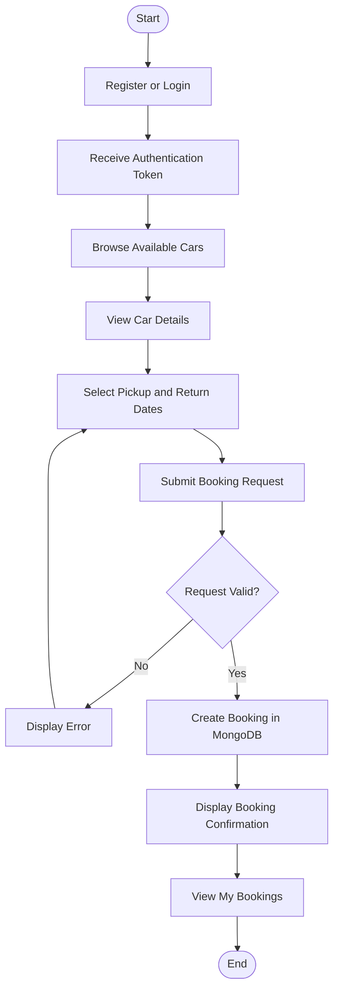
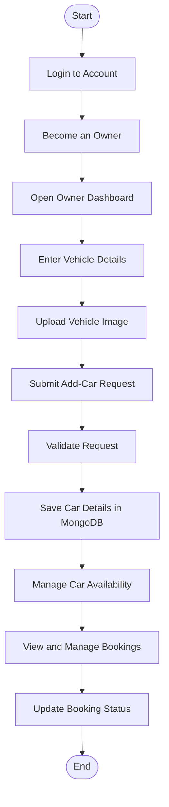
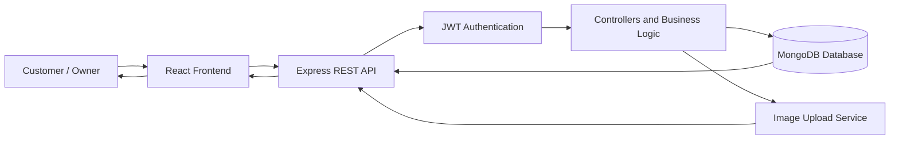

# 🚗 Dahiya Car Rentals — Full-Stack Web Application

A full-stack car rental platform built with the MERN stack, enabling customers to explore available vehicles, book cars, and manage reservations while car owners can list vehicles, manage availability, track bookings, and monitor dashboard statistics.

<p align="left">
  
  
  
  
  
  
</p>

---

## 📑 Table of Contents

- [Overview](#-overview)
- [Features](#-features)
- [Application Workflows](#-application-workflows)
- [Technology Stack](#️-technology-stack)
- [Project Structure](#-project-structure)
- [Getting Started](#-getting-started)
- [Environment Variables](#-environment-variables)
- [API Documentation](#-api-documentation)
- [Testing the APIs](#-testing-the-apis)
- [Security](#-security)
- [Future Improvements](#-future-improvements)
- [Author](#-author)
- [License](#-license)

## 🌟 Overview

Dahiya Car Rentals provides a centralized platform for customers and vehicle owners to manage the car rental process.

Customers can discover vehicles, view car details, select pickup and return dates, and track their bookings. Owners can add vehicles with images, manage availability, update booking statuses, and access dashboard statistics.

The application uses a REST API architecture with JWT-based authentication and MongoDB for data persistence.

## ✨ Features

### 👤 Customer Features

- **User Authentication:** Register and log in securely.
- **Car Discovery:** Browse available vehicles.
- **Car Details:** View individual vehicle information.
- **Car Booking:** Select pickup and return dates to create a reservation.
- **My Bookings:** View personal booking records.
- **Protected Access:** Access account-specific features using JWT authentication.

### 🏢 Owner Features

- **Role Management:** Upgrade a customer account to an owner account.
- **Vehicle Listings:** Add new cars with image uploads.
- **Manage Cars:** View and manage owned vehicles.
- **Availability Control:** Enable or disable car availability.
- **Booking Management:** View bookings for listed vehicles.
- **Booking Status:** Update booking statuses.
- **Dashboard Analytics:** Retrieve car, booking, and other configured statistics.

### 🔐 Security Features

- JWT-based authentication for protected endpoints.
- Role-based access control for owner operations.
- Environment variables for sensitive configuration.
- Server-side request validation and authorization.

## 🔄 Application Workflows

### 1. Customer Booking Workflow



### 2. Owner Vehicle Management Workflow



### 3. System Architecture



> **Note:** The image upload service represents the configured image-storage integration. Configure ImageKit if your backend uses it.

## 🛠️ Technology Stack

| Layer | Technologies |
|---|---|
| Frontend | React, Vite |
| Backend | Node.js, Express.js |
| Database | MongoDB, Mongoose |
| Authentication | JSON Web Tokens (JWT) |
| Image Upload | Multer and configured image-storage provider |
| API Communication | HTTP, JSON, multipart/form-data |
| Development Tools | Git, GitHub, VS Code, Postman |

*Update the stack to match the exact dependencies in your repository.*

## 📂 Project Structure

The following is a suggested directory structure. Adjust it to match the actual files in your repository.

```text
Car-rentals/
├── client/                     # React frontend
│   ├── public/                 # Static assets
│   ├── src/
│   │   ├── assets/              # Images and other assets
│   │   ├── components/          # Reusable components
│   │   ├── context/             # Application context
│   │   ├── pages/               # Customer-facing pages
│   │   └── pages/owner/         # Owner dashboard pages
│   ├── .env.example
│   └── package.json
│
├── server/                     # Node.js backend
│   ├── configs/                 # Database and service configuration
│   ├── controllers/             # Request handlers
│   ├── middleware/              # Authentication and upload middleware
│   ├── models/                  # MongoDB models
│   ├── routes/                  # API routes
│   ├── server.js                # Server entry point
│   ├── .env.example
│   └── package.json
│
├── .gitignore
└── README.md
```

## 🚀 Getting Started

Follow these steps to run the project locally on Windows, macOS, or Linux.

### Prerequisites

Install the following tools:

- [Node.js](https://nodejs.org/) — use a version compatible with the project dependencies.
- [MongoDB Atlas](https://www.mongodb.com/atlas) or a local MongoDB server.
- [Git](https://git-scm.com/).
- [Visual Studio Code](https://code.visualstudio.com/) (recommended).

If your project uses a cloud image service, configure its credentials as well.

### 1. Clone the Repository

Open PowerShell or your terminal:

```bash
git clone https://github.com/adityadahiya12/Car-rentals.git
cd Car-rentals
```

### 2. Configure the Backend

```powershell
cd server
npm install
```

Create a `.env` file inside the `server` directory:

```env
PORT=3000
MONGODB_URI=your_mongodb_connection_string
JWT_SECRET=your_long_random_secret
IMAGEKIT_PUBLIC_KEY=your_imagekit_public_key
IMAGEKIT_PRIVATE_KEY=your_imagekit_private_key
IMAGEKIT_URL_ENDPOINT=https://ik.imagekit.io/your_imagekit_id
```

The ImageKit variables are needed only if your backend uses ImageKit. Rename variables to match the names referenced by your source code.

Start the backend using the script defined in `server/package.json`:

```powershell
npm run dev
```

If that script does not exist, check the available scripts with:

```powershell
npm run
```

The API should be available at:

```text
http://localhost:3000
```

Verify the server using `GET /`.

### 3. Configure the Frontend

Open a second terminal from the repository root:

```powershell
cd client
npm install
```

If your frontend reads the API URL from `VITE_BASE_URL`, create `client/.env`:

```env
VITE_BASE_URL=http://localhost:3000
```

Use the exact environment variable expected by your frontend code.

Start the development server:

```powershell
npm run dev
```

Open the local URL printed in the terminal, commonly:

```text
http://localhost:5173
```

### 4. Verify the Application

- Confirm the backend starts without errors.
- Confirm the database connection succeeds.
- Register a test account.
- Log in and verify authenticated requests.
- Browse cars and test the booking workflow.
- Test owner operations using an owner account.
- Verify image uploads if image storage is configured.

## 🔑 Environment Variables

| Variable | Purpose | Required |
|---|---|---|
| `PORT` | Backend server port | Yes |
| `MONGODB_URI` | MongoDB connection string | Yes |
| `JWT_SECRET` | Secret used for JWT signing and verification | Yes |
| `IMAGEKIT_PUBLIC_KEY` | ImageKit public key | If using ImageKit |
| `IMAGEKIT_PRIVATE_KEY` | ImageKit private key | If using ImageKit |
| `IMAGEKIT_URL_ENDPOINT` | ImageKit URL endpoint | If using ImageKit |
| `VITE_BASE_URL` | Backend API URL used by the frontend | If referenced by frontend |

**Important:** These names are examples based on the suggested setup. Confirm the actual variable names in your backend configuration and frontend source code before running the application.

Never commit real credentials or secret values to GitHub.

## 📡 API Documentation

**Base URL:** `http://localhost:3000`

The backend provides **16 API endpoints** across general health checks, customer operations, and owner management.

### General API

| Method | Endpoint | Description | Access |
|---|---|---|---|
| `GET` | `/` | Server health check | Public |

### User APIs

| Method | Endpoint | Description | Access |
|---|---|---|---|
| `POST` | `/api/user/register` | Register a new user | Public |
| `POST` | `/api/user/login` | Authenticate a user | Public |
| `GET` | `/api/user/data` | Retrieve current user details | Protected |
| `GET` | `/api/user/cars` | List available cars | Public |
| `GET` | `/api/user/cars/:id` | Retrieve car details | Public |
| `POST` | `/api/user/book` | Create a car booking | Protected |
| `GET` | `/api/user/my-bookings` | Retrieve the user's bookings | Protected |

### Owner APIs

| Method | Endpoint | Description | Access |
|---|---|---|---|
| `POST` | `/api/owner/change-role` | Become an owner | Protected |
| `POST` | `/api/owner/add-car` | Add a car with an image | Protected |
| `GET` | `/api/owner/cars` | Retrieve the owner's cars | Protected |
| `POST` | `/api/owner/toggle-car` | Toggle car availability | Protected |
| `POST` | `/api/owner/delete-car` | Delete a car listing | Protected |
| `GET` | `/api/owner/bookings` | Retrieve bookings for owned cars | Protected |
| `POST` | `/api/owner/change-status` | Update booking status | Protected |
| `GET` | `/api/owner/dashboard` | Retrieve dashboard statistics | Protected |

### Authentication Header

All protected endpoints require a valid token:

```http
Authorization: Bearer <token>
```

### Example: Register a User

**Request**

```http
POST /api/user/register
Content-Type: application/json
```

```json
{
  "name": "Aditya",
  "email": "aditya@example.com",
  "password": "your_password"
}
```

### Example: Log In

**Request**

```http
POST /api/user/login
Content-Type: application/json
```

```json
{
  "email": "aditya@example.com",
  "password": "your_password"
}
```

Use the token returned by your API for protected requests, according to your backend's response format.

### Example: Book a Car

**Request**

```http
POST /api/user/book
Authorization: Bearer <token>
Content-Type: application/json
```

```json
{
  "carId": "YOUR_CAR_ID",
  "pickupDate": "2026-11-01",
  "returnDate": "2026-11-05"
}
```

Replace `YOUR_CAR_ID` with a valid car ID from the cars endpoint.

### Example: Add a Car

**Request**

```http
POST /api/owner/add-car
Authorization: Bearer <token>
Content-Type: multipart/form-data
```

Form-data fields:

| Field | Type | Description |
|---|---|---|
| `image` | File | Vehicle image |
| `carData` | Text | Car data in the format expected by the backend |

Use Postman’s **Body → form-data** option. The `carData` format must match the implementation in your backend controller.

## 🧪 Testing the APIs

You can test endpoints using:

- [Postman](https://www.postman.com/) — API testing and request collections.
- [Thunder Client](https://www.thunderclient.com/) — API testing inside VS Code.
- [cURL](https://curl.se/) — Command-line API requests.

### Check Server Health

```bash
curl http://localhost:3000/
```

### Fetch Available Cars

```bash
curl http://localhost:3000/api/user/cars
```

### Fetch Current User

```bash
curl http://localhost:3000/api/user/data \
  -H "Authorization: Bearer YOUR_JWT_TOKEN"
```

Replace `YOUR_JWT_TOKEN` with a valid token.

## 🛡️ Security

- Store secrets in environment variables.
- Exclude `.env` files from version control.
- Validate and sanitize incoming request data.
- Verify JWTs on protected endpoints.
- Enforce owner authorization on vehicle and booking operations.
- Validate booking dates and car availability on the server.
- Use HTTPS in production.
- Avoid logging passwords, tokens, or other sensitive data.

## 🔮 Future Improvements

Potential enhancements for the platform include:

- Online payments and booking receipts.
- Advanced search by location, price, fuel type, and transmission.
- Real-time booking availability.
- Email and SMS booking notifications.
- Customer reviews and ratings.
- Booking cancellation policies.
- Automated API testing and CI/CD deployment.
- Production hosting with a custom domain.

## 👨‍💻 Author

**Aditya Dahiya**

- GitHub: [@adityadahiya12](https://github.com/adityadahiya12)
- Portfolio: [Personal Portfolio](https://adityadahiya12.github.io/Personal_portfolio/)

## 📄 License

Choose and add a license that matches your project's intended use. For example, an MIT license requires adding a `LICENSE` file to the repository.

---

<p align="center">
  Built with ❤️ by <a href="https://github.com/adityadahiya12">Aditya Dahiya</a>
</p>
